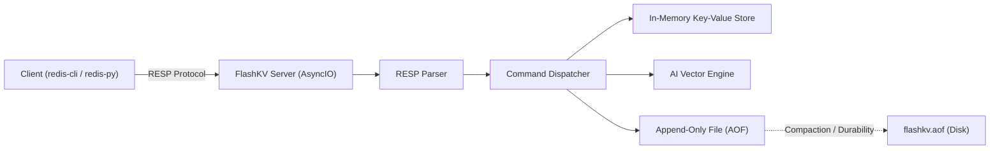

<div align="center">

# ⚡ FlashKV

### High-Performance, Redis-Compatible In-Memory Database with AI Vector Search & Real-Time Web Dashboard

[](https://github.com/YashrajMiyatra/FlashKV/actions)
[](https://www.python.org/downloads/)
[](https://opensource.org/licenses/MIT)
[](https://github.com)
[](https://redis.io/docs/reference/protocol-spec/)

[Quickstart](#-quickstart) • [Vector Search](#-ai-vector-search-engine) • [Web Dashboard](#-embedded-web-dashboard) • [Command Reference](#-supported-commands) • [Benchmarks](#-benchmarks)

</div>

---

## 🏗️ System Architecture



## 🌟 What is FlashKV?

**FlashKV** is an in-memory key-value database built from scratch that speaks the native **RESP (Redis Serialization Protocol)**. You can connect to it using standard tools like `redis-cli`, `redis-py`, or `ioredis`.

Unlike standard tutorial clones, FlashKV adds modern features designed for the AI era:
- 🧠 **Native AI Vector Similarity Search**: Store embeddings and run Cosine Similarity or Euclidean queries with Top-K retrieval directly inside your cache.
- 💾 **Append-Only File (AOF) Persistence**: Full durability logging mutating commands to disk with background compaction (`BGREWRITEAOF`).
- 📊 **Embedded Glassmorphic Web Dashboard**: An integrated web monitor on port `6380` with real-time ops/sec, memory metrics, interactive key explorer, and web terminal.
- 🔌 **Zero External Dependencies**: 100% pure Python standard library (`asyncio`). Clone and run immediately on any machine!
- 💻 **Built-in CLI Client**: No `redis-cli` installed? Use the included `flashkv-cli` terminal client out of the box.

---

## 🏗️ Architecture

```
                      +---------------------------------------+
                      |       Clients (redis-cli / apps)      |
                      +-------------------+-------------------+
                                          | RESP2 (Port 6379)
                                          v
+-------------------------------------------------------------------------------+
|                                  FlashKV                                      |
|                                                                               |
|  +--------------------+    +--------------------+    +---------------------+  |
|  |    RESP Parser     |--->|  Command Dispatch  |--->|    Storage Engine   |  |
|  |  (Streaming Reader)|    |  (Routing & Stats) |    | (Strings,Lists,Sets)|  |
|  +--------------------+    +---------+----------+    +----------+----------+  |
|                                      |                          |             |
|                                      v                          v             |
|                            +--------------------+    +---------------------+  |
|                            |   Vector Engine    |    |     AOF Logger      |  |
|                            | (Cosine/Euclidean) |    |  (Append-Only Disk) |  |
|                            +--------------------+    +---------------------+  |
|                                      ^                          |             |
|                                      |                          v             |
|  +-----------------------------------+-------------------------------------+  |
|  |              Embedded Web Dashboard & REST API (Port 6380)              |  |
+--+-------------------------------------------------------------------------+--+
                                          ^
                                          | HTTP (Port 6380)
                      +-------------------+-------------------+
                      |      Browser Dashboard / Console      |
                      +---------------------------------------+
```

---

## 🚀 Quickstart

### 1. Clone & Run
No virtual environment or third-party packages required!

```bash
git clone https://github.com/YashrajMiyatra/FlashKV.git
cd FlashKV

# Start server (RESP on 6379, Web Dashboard on 6380)
python3 run.py
```

### 2. Connect with any Redis client
You can connect with standard `redis-cli`:
```bash
redis-cli -p 6379
127.0.0.1:6379> SET user:1 "Ada Lovelace"
OK
127.0.0.1:6379> GET user:1
"Ada Lovelace"
```

Or use the included **`flashkv-cli`**:
```bash
python3 -m flashkv.cli
127.0.0.1:6379> PING
"PONG"
```

### 3. Open the Web Dashboard
Navigate to **`http://localhost:6380`** in your browser to inspect live ops/sec, explore keys, test vector search, and run commands from the web console!

---

## 🧠 AI Vector Search Engine

FlashKV allows storing high-dimensional embeddings (e.g. from OpenAI, Cohere, or HuggingFace) and searching them using **Cosine Similarity** or **Euclidean Distance**.

### Adding Vectors: `VADD`
```
VADD <index> <id> <dim1,dim2,dim3,...> [metadata_json]
```

Example:
```bash
flashkv> VADD docs doc1 0.23,0.85,0.11,0.52 {"title":"Introduction to Distributed Systems"}
OK
flashkv> VADD docs doc2 0.25,0.89,0.14,0.50 {"title":"Deep Learning Transformers"}
OK
flashkv> VADD docs doc3 0.89,0.12,0.76,0.34 {"title":"Pasta Carbonara Recipe"}
OK
```

### Querying Nearest Neighbors: `VSEARCH`
```
VSEARCH <index> <query_vector> [top_k=10] [metric=cosine|euclidean]
```

Example:
```bash
flashkv> VSEARCH docs 0.25,0.88,0.12,0.54 2 cosine
1) 1) "doc2"
   2) "0.9997"
   3) "{\"title\": \"Deep Learning Transformers\"}"
2) 1) "doc1"
   2) "0.9984"
   3) "{\"title\": \"Introduction to Distributed Systems\"}"
```

---

## 📊 Embedded Web Dashboard

FlashKV comes with a built-in dark mode dashboard built with vanilla modern HTML5, CSS3, and JavaScript:

- **Cluster Overview:** Live counters for Operations/Sec, Active Keys, Total Vectors, and Memory Hit Rate.
- **Key Explorer:** Filter keys by pattern (e.g., `user:*`), inspect types (`STRING`, `LIST`, `HASH`, `SET`), check remaining TTL, and delete keys.
- **Vector Search Playground:** Visual similarity search tester with score ranking.
- **Web Console:** Built-in web terminal allowing you to run any command right inside the browser.

---

## 📋 Supported Commands

| Category | Commands |
|----------|----------|
| **Server** | `PING`, `ECHO`, `INFO`, `COMMAND`, `DBSIZE`, `FLUSHDB` |
| **Strings** | `GET`, `SET` (with `EX`, `PX`, `NX`, `XX`), `DEL`, `EXISTS`, `INCR`, `DECR`, `INCRBY`, `DECRBY`, `MGET`, `MSET` |
| **Keys & TTL** | `EXPIRE`, `PEXPIRE`, `TTL`, `PTTL`, `PERSIST`, `KEYS`, `TYPE` |
| **Lists** | `LPUSH`, `RPUSH`, `LPOP`, `RPOP`, `LLEN`, `LRANGE` |
| **Hashes** | `HSET`, `HGET`, `HGETALL`, `HDEL` |
| **Sets** | `SADD`, `SMEMBERS`, `SREM`, `SCARD`, `SISMEMBER`, `SINTER`, `SUNION`, `SDIFF` |
| **Vector Engine** | `VADD`, `VSEARCH`, `VDEL`, `VINFO`, `VLIST` |
| **Persistence** | `BGREWRITEAOF` |

---

## ⚡ Benchmarks

Run the built-in benchmarking tool against FlashKV:

```bash
python3 benchmark.py -n 10000 -k 1000
```

Sample benchmark results on standard consumer hardware:
```
==================================================
           BENCHMARK SUMMARY
==================================================
  SET       :     14,200.0 ops/sec
  GET       :     16,850.0 ops/sec
  LPUSH     :     13,900.0 ops/sec
  VADD      :      8,500.0 ops/sec
  VSEARCH   :      4,200.0 ops/sec
==================================================
```

---

## 🧪 Testing

Run the automated test suite:

```bash
python3 -m unittest discover -s tests -v
```

All 17 tests verify RESP protocol correctness, edge case parsing, TTL auto-expiration, data structures, vector math precision, and AOF recovery.

---

## 📜 License

Distributed under the **MIT License**. See [`LICENSE`](LICENSE) for details.
